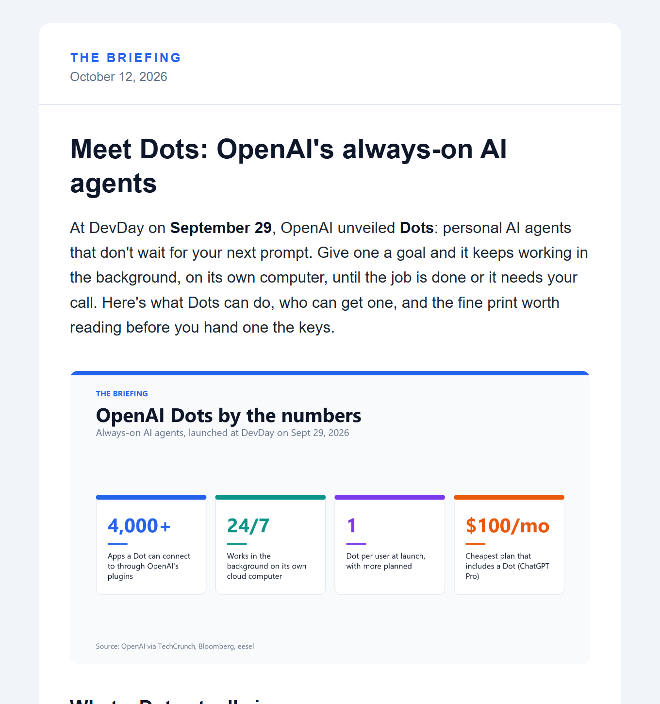

# AI Newsletter Workflow

Give it a topic. It returns a researched HTML newsletter with an infographic, saved as a Gmail draft for you to approve before it goes out.



## How it works

Built on a **Workflows, Agents, Tools** split:
- **Workflows** (`workflows/`): plain-language SOPs that say what to do and in what order.
- **Agent** (Claude Code): reads the workflow, does the research and writing, and handles errors.
- **Tools** (`tools/`): small Python scripts that do the deterministic work.

AI handles the judgment. Code handles the execution. That keeps a multi-step run reliable.

## Pipeline

1. **Research:** 5+ recent, authoritative sources. Only facts that were actually found.
2. **Write:** `content.json` (subject, sections, takeaways, sources, infographic stats).
3. **Validate:** `validate_content.py` checks the schema and length limits.
4. **Infographic:** `draw_infographic.py` draws a 1600x900 stat card with Pillow.
5. **Build:** `build_html.py` renders email-safe HTML with inline (CID) images.
6. **Draft:** `gmail_send.py --draft` creates a Gmail draft through the Gmail API.
7. **Human approval**, then `gmail_send.py --send <draft_id>`.

Default mode costs nothing. An optional paid path (`research_topic.py`, `write_newsletter.py`, `generate_infographic.py`) uses the Claude API and an image API for fully unattended runs.

## Setup

```bash
pip install -r requirements.txt
cp .env.example .env          # set NEWSLETTER_NAME and NEWSLETTER_TO
# add your Google OAuth client as credentials.json (Gmail API enabled)
python tools/gmail_send.py --auth
```

Full steps and edge cases: `workflows/create_newsletter.md`.

## Built by

Dickson Kisundi, AI automation specialist, Mombasa, Kenya.
